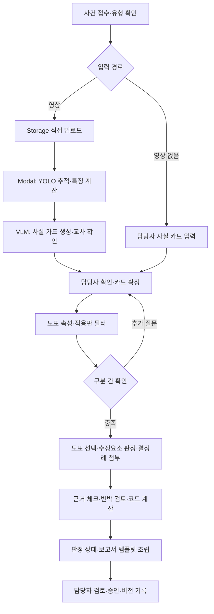

# ok-muncheol-be

**옥문철 — AI 기반 자동차보험 보상 의사결정 지원 솔루션의 백엔드**

블랙박스 영상이나 담당자가 입력한 사고 사실을 구조화하고, 과실비율 인정기준·분쟁심의 결정례에 근거한
**과실비율 검토 초안**을 제공한다. 최종 판단과 승인은 보상 담당자가 수행한다.

- 설계 원본: [AI 기반 자동차보험 보상 의사결정 지원 솔루션 설계 초안](https://app.notion.com/p/40eada0d3ad7816d91b0c73930ba2455) — 2026-11-05 확인
- 아키텍처 이미지: [accident-review-architecture-v7.png](docs/architecture/accident-review-architecture-v7.png) — 로컬 `ok-muncheol/서비스아키텍처` 원본, 2026-11-05 대조
- 프론트엔드: [ok-muncheol-fe](https://github.com/Ok-Muncheol/ok-muncheol-fe)
- 역할별 작업·완료 기준: [TEAM.md](TEAM.md)

현재는 **문서 초기화 단계**다. 이 저장소에는 README.md·TEAM.md와 아키텍처 참고 이미지가 있으며, 아래 디렉터리·API·개발 명령은
구현을 위한 제안이다. 실행 가능한 서버, 모델, DB 마이그레이션, CI, 배포 설정은 아직 없다.

## 서비스 범위

| 단계 | 범위 | 산출물 |
| --- | --- | --- |
| 선행 MVP | 차대차 사고, 영상 또는 수동 사실 카드 → 담당자 확인 → 도표·수정요소 판단 → 검증 | 근거가 있는 과실비율 검토 초안 |
| 1차 확장 | 차대차·자차, 약관 RAG, 손해액·보험금, 근거 질의응답·what-if, 구상 청구 | 자차 산정 보고서, 구상 패키지(PDF·JSON) |
| 2차 확장 | 이륜차, 대물·대인·자손·자상, 양방향 정산 | 담보별 산정과 정산표 |

차대보행자·차대자전거·PM·3대 이상 연쇄 사고·단독 사고는 범위 밖이다. 접수 시 사고 유형과 당사자 수를 확인한다.
영상이 없는 진술서 사건도 동일한 사실 카드를 직접 입력해 지원한다. 운전자보험은 포함하지 않는다.

## 핵심 원칙

1. **사실 카드 확정 후 판단한다.** 비전이 추출한 값·근거·확신도와 담당자의 수정 이력을 보존한다. 핵심 구분 칸이 불명하거나 충돌하면 질문하고, 확인할 수 없으면 보류한다.
2. **숫자는 코드로 계산한다.** 기본 과실·가감치는 사고 일자에 유효한 DB 레코드에서 읽는다. LLM이 생성한 비율이나 금액을 계산 입력으로 쓰지 않는다.
3. **근거가 있어야 초안을 낸다.** 도표 번호·적용판·수정요소 코드·인용 원문을 검증한다. 판례를 인용할 때는 판례 식별자도 검증한다.
4. **공식 판단은 고정 워크플로우다.** LangGraph의 조건 분기와 담당자 확인·재개로 실행한다. 확장 단계의 질의응답 에이전트는 설명·가정 계산만 하며 공식 결과를 직접 수정하지 않는다.
5. **단계별로 저장하고 재실행한다.** 카드·기준판·규칙·모델 버전과 실행 로그를 남긴다. 사실 변경 시 판단부터, 견적 추가 시 손해액·보험금부터 다시 실행한다.

## 아키텍처 원본과 적용 기준


이미지는 로컬 원본을 수정 없이 보관한 **확장 기능 포함 전체 흐름 참고도**다. 사실 카드 경계, 담당자 확인과
구분 질문, 근거 체크·반박 검토·코드 계산의 3겹 검증, 보고서 템플릿 조립, 서류 추가 재산정,
공식 결과와 분리된 what-if 실행 관계를 보여 준다. 모든 상자를 선행 MVP의 구현 범위로 해석하지 않는다.

이미지의 일부 상세 표기와 2026-11-05 Notion 텍스트가 달라, 다음 항목은 최신 텍스트를 적용한다.

| 이미지 v7 표기 | 적용할 기준 |
| --- | --- |
| YOLO + SAM2 | YOLO를 우선 사용하고 SAM2는 개선 효과가 입증된 경우 선택적으로 추가 |
| 확신도 0.7 미만 칸 질문 | 핵심 필드의 불명·저확신·근거 불일치와 후보 도표 구분 칸으로 확인 여부 결정. 0.7은 이미지의 제안값이며 운영 임계값은 평가 후 확정 |
| 수정요소 판정 LLM, 요소마다 | 구조화 조건·증거 요구·중복/배타는 코드 우선, 해석이 필요한 요소만 LLM 보조·담당자 확인 |
| 공통 검색 함수: 필터→벡터·BM25·trigram→재순위 | 코퍼스별 검색 전략 적용. 도표는 속성·유효판 우선, 결정례는 유사도, 약관은 담보·조항 우선. 결합·재순위는 효과를 검증해 선택 |
| 손해액·보험금·약관·구상·질의응답과 9항목 보고서 | 선행 MVP는 과실비율 검토 1~7번, 1차에 자차·약관·what-if·구상과 8~9번 추가. 진료비·대인 등은 2차 |
| 분담액 = 지급액 × 상대 과실비율 | 구상 예정액의 단순 예시. 실제 청구·회수액은 계약·지급·정산 조건 검증 후 별도 관리 |

## 선행 MVP 처리 흐름



SAM2는 YOLO만으로 부족한 차로 점유·경계 확인에서 개선 효과를 검증한 뒤 선택적으로 추가한다.
마스크 접촉으로 실제 충돌을 확정하거나 픽셀 변위로 실제 속도·과속을 판정하지 않는다.

반박이 성립하면 차순위 도표로 선택·판정·검증을 한 번만 재실행하고, 두 번째 반박도 성립하면
‘추가 확인 필요’로 내린다. 같은 사실·기준판·계산 규칙에 대한 수치 계산은 재현 가능하게 만든다.

## 기술 구성

| 구성 | 설계 기술 | 역할 |
| --- | --- | --- |
| API | Python · FastAPI · Vercel Functions | 사건·사실 카드·판단 실행·보고서·권한 |
| 비동기 작업 | Vercel Queues | 단계별 작업 실행·재시도·진행 상태 기록 |
| 비전 워커 | Modal GPU · YOLO · OpenCV, SAM2 선택 | 탐지·추적·특징·근거 프레임 |
| 판단 | LangGraph, VLM·LLM API | 구조화 사실 추출·고정 판단 그래프·반박 검토 |
| 검색·색인 | LangChain · Kiwi · pgvector · pg_trgm | 코퍼스별 전처리·구조화 검색·한국어 BM25 |
| 데이터·파일·인증 | Supabase Postgres · Storage · Auth · RLS | 사건·근거·비공개 영상·담당자 접근 통제 |
| 진행·관측 | Supabase Realtime · LangSmith · Vercel Observability | 작업 변경 알림·단계별 비용·처리 시간 |

영상은 FE가 발급받은 서명 URL로 Storage에 직접 올리고 API에는 파일 경로·메타데이터를 전달한다.
YOLO·SAM2 가중치와 GPU 실행 환경은 API 함수에 포함하지 않는다. 서비스와 로컬 비전 평가는 같은 패키지·가중치 버전을 쓴다.

**배포는 아직 구성하지 않았다.** 설계 원본은 FE·API를 한 Vercel 프로젝트로 배포하는 목표다.
두 Git 저장소를 그 배포 단위에 연결하는 방식(빌드 시 결합 또는 통합 배포 저장소), 라우팅·CORS·환경 변수는
초기 인프라 작업에서 결정한다. lumi의 별도 프로젝트 배포 설정을 그대로 복제하지 않는다.
요금·함수 제한·제품 지원 조건은 실제 구성 시 공식 문서로 다시 확인한다.

## 사고 사실 카드 계약

비전과 판단은 이 카드만으로 연결한다. 다음은 초기 필드 합의안이며 실제 Pydantic·OpenAPI 스키마는 첫 계약 PR에서 확정한다.

| 영역 | 필드 |
| --- | --- |
| 사건 | `accident_type`, 사고 일시, 당사자 수 |
| 당사자 | `party_tracks`, `video_ego_party_id`, `insured_party_id`, `chart_party_A_id`, `chart_party_B_id` |
| 장소·신호 | `location_type`, `signal_state_A/B`, `priority_road` |
| 움직임 | `movement_A/B`, `lane_change_A/B`, `motion_trend_A/B` |
| 보조 사실 | `collision_point`, `time_condition`, `narrative`, `evidence_frames` |

각 사실 필드는 `value`, `source`, `model_confidence`, `verification_status`, `evidence_frame_ids`를 가진다.
`needs_review`는 근거 충돌·확인 필요, `human_confirmed`는 담당자 확인을 뜻한다. 수동 입력에서 모델 확신도는
해당 없음으로 표현하고, 담당자 수정 때문에 원래 모델 확신도를 1.0으로 덮어쓰지 않는다.
영상이 없는 사건에는 근거 프레임이 없음을 명시하고 진술서 등 입력 근거를 별도로 연결하는 계약을 마련한다.

촬영 차량·보험가입자·도표 A/B·데이터셋 A/B를 같은 것으로 가정하지 않는다. 카드 확정 및 과실 계산 전에 매핑을 검증한다.
수정 전후 값, 수정자, 시각, 근거와 사유를 이력으로 남긴다.

## 지식베이스·판단 규칙

| 코퍼스 | 주요 레코드 | 검색과 사용 단계 |
| --- | --- | --- |
| ① 인정기준 | `chart`, `modifier`, `chart_relation`, `precedent` | 사실 속성·`condition_json`·사고 일자에 유효한 판으로 후보 제한, 과실 판단 |
| ② 분쟁심의 결정례 | `dispute_case` | `chart_id` 필터 후 유사 사실 검색, 벡터·Kiwi BM25 결합은 평가 후 적용 |
| ③ 약관·보상 지침 | `term_clause` | 1차 확장부터 담보·조항 필터, 보상 범위·면책 검토에 사용 |
| 공통 색인 | `search_chunk`, `token_stats` | 근거 원문·부모 ID·버전 보존, 코퍼스별 토큰 통계 |

①·②와 ③의 검색 범위를 섞지 않는다. 구조화 조건을 우선하며 RRF·재순위·Contextual Retrieval은 코퍼스별
효과를 측정해 채택한다. 도표는 개정 전 판도 보존하고 사고 일자로 조회한다. 수치는 청크 서술이 아닌 DB에서 읽는다.

```text
fault_A = clip(base_A + sum(delta of A modifiers) - sum(delta of B modifiers), 0, 100)
fault_B = 100 - fault_A
```

수정요소의 조건·증거 요구사항·중복·상호배타·적용 방향·부호를 코드로 검증한다.
근거가 없는 수정요소는 임의 적용하지 않는다.

## 판정 상태와 보고서

작업 진행 상태와 판정 결과는 별개다. 작업이 끝나도 결과는 보류일 수 있다.

| 판정 | 조건·화면 동작 |
| --- | --- |
| 초안 작성 가능 | 필수 증거·확인·근거 검증·반박 검토·수치 계산을 통과해 담당자 검토용 초안 제공 |
| 추가 확인 필요 | 답변 가능한 불명·충돌 또는 반복 반박이 남아 질문과 쟁점 제공 |
| 판단 보류 | 구분 불가·확인 불가 또는 범위 밖 사유 제공, 확정 비율로 표시하지 않음 |

MVP 보고서는 ① 판정 상태 ② 확정 사실·근거 키프레임 ③ 적용 도표·차순위 후보·선택/제외 이유
④ 기본 과실 ⑤ 적용/미적용/불명 수정요소 ⑥ 최종 과실비율 초안·계산 로그 ⑦ 추가 확인 사항으로 구성한다.
템플릿과 검증된 판단 결과로 조립하며 보고서 작성용 LLM을 추가 호출하지 않는다. 담당자 승인은 별도 이력으로 저장한다.
근거가 부족한 사건은 확인·보류 결과만 제공한다. 담당자 승인 없이 외부 전달하지 않는다.

## 디렉터리 제안

아래는 구현 후 구조 제안이다. 현재 `docs/architecture/`에는 참고 이미지만 있으며, 나머지 구현 경로는 기능 작업을 시작할 때 생성한다.

```text
app/
  api/              사건·카드·질문·보고서 API
  schemas/          사실 카드·판단·보고서 계약 (FE 타입의 원천)
  workflow/         state·고정 그래프·확인/재개·검증
  retrieval/        도표·결정례·약관별 검색
  calculation/      과실 계산, 확장 단계의 보험금·구상 계산
  reports/          템플릿 조립·승인·버전
  ingestion/        도표 구조화·검수·색인
workers/vision/     Modal 작업, 로컬 평가와 공유하는 비전 패키지
supabase/migrations/  테이블·RLS·검색 함수
tests/              계약·계산·워크플로우·권한 검증
evals/              데이터 분할·S0~S5 비교 평가
docs/               계약 변경·설계 결정
```

## API 계약 제안

**현재 구현된 엔드포인트는 없다.** 다음은 FE·BE가 함께 확정할 초안이며 동작하는 API 명세가 아니다.
접두사·인증·필드·오류·비동기 재개 방식은 첫 계약 PR에서 OpenAPI와 예제로 고정한다.

| 요청 | 목적 |
| --- | --- |
| `POST /cases` | 사건 생성·범위 검사 |
| `POST /cases/{id}/uploads` | 담당 사건 파일의 업로드 서명 URL 발급 |
| `POST /cases/{id}/analysis` | 영상 분석 작업 접수 |
| `GET /cases/{id}` | 진행 상태·확인 질문·현재 버전 복원 |
| `GET /cases/{id}/fact-card` | 모델 원값·현재 값·근거·확인 상태 조회 |
| `PATCH /cases/{id}/fact-card` | 기대 카드 버전과 수정 내역 전달 |
| `POST /cases/{id}/fact-card/confirm` | 담당자 카드 확정 |
| `POST /cases/{id}/questions/{question_id}/answer` | 도표 구분 질문 응답·카드 이력 반영 |
| `POST /cases/{id}/judgments` | 확정 카드 버전으로 판단 작업 접수·재개 |
| `GET /cases/{id}/reports/{version}` | 버전별 보고서·근거·판정 조회 |
| `POST /cases/{id}/reports/{version}/approve` | 담당자 검토·승인 이력 저장 |

합의할 공통 계약은 사건 ID, 카드/보고서 버전, 작업 ID·단계·진행 상태, 판정 상태, 확인 질문,
근거 ID·타임스탬프, 오류 코드·재시도 가능 여부다. 오래된 카드에 대한 덮어쓰기와 중복 실행을 막는다.
재시도에는 사건 ID + 단계 + 입력 버전 기반 멱등성 키를 사용한다. Realtime은 변경 알림으로 사용하고
재접속·새로고침 후에는 조회 API로 현재 상태를 복원한다.

## 개발 시작과 검증

지금 가능한 작업은 문서 확인과 계약 논의다.

```bash
git clone https://github.com/Ok-Muncheol/ok-muncheol-be.git
cd ok-muncheol-be
```

Python 버전·의존성·패키지 관리자, `.env.example`, 개발 서버와 테스트 명령은 부트스트랩 PR에서 확정해 여기에 추가한다.
`make lint`·`make test`는 lumi와 같은 팀 인터페이스로 도입하는 제안이며 **현재 실행할 수 없다**.
LLM·VLM·Modal·DB 비밀키는 서버 환경에서만 관리하고, `.env`와 실제 사건 자료는 커밋하지 않는다.

평가는 영상→카드와 카드→판단을 분리한다. 먼저 정답 카드로 S0(벡터 검색 기준선), S1(속성 필터·검색 개선),
S2(고정 판단·검증)를 비교하고, S3(VLM), S4(YOLO·선택적 SAM2), S5(담당자 확인) 순으로 확장한다.
도표 Top-1·Recall@3, 수정요소 정밀도·재현율, 비율 MAE(%p)·±5%p 적중률, 고확신 오류율·보류율,
담당자 수정 횟수·처리 시간 p50/p95·비용을 함께 기록한다. 목표 수치와 데이터 규모는 아직 확정하지 않았다.

## 협업·데이터 관리

- 이슈 → `main`에서 `<타입>/#<이슈 번호>` 브랜치 → `main` PR → 검증 → squash merge를 기본 규칙으로 제안한다. 예: `feat/#12`, PR 제목 `[feat/#12] 사실 카드 계약 추가`, 본문 `close #12`.
- CI·브랜치 보호·ship 자동화는 아직 없다. 구축 후 실제 검사 이름과 명령을 문서에 추가한다.
- AI Hub 원본 영상은 설계대로 로컬 학습·평가용으로만 보관한다. 서비스·공개 시연에는 사용 권리를 확인한 별도 영상을 쓴다.
- 인정기준·결정례·약관의 재가공·배포 범위와 모델·가중치 라이선스는 확인 전 공개 저장소에 원문·가중치를 올리지 않는다.
- 얼굴·번호판·위치정보 처리, 외부 VLM 전송, 접근 권한·보관·삭제 정책은 실데이터 연동 전 확정한다.
- 담당자 실명 배정·일정, 도표/라벨 매핑·적용판, 시연 데이터 확보, 배포 연결 방식은 [TEAM.md](TEAM.md)의 초기 작업에서 결정한다.
