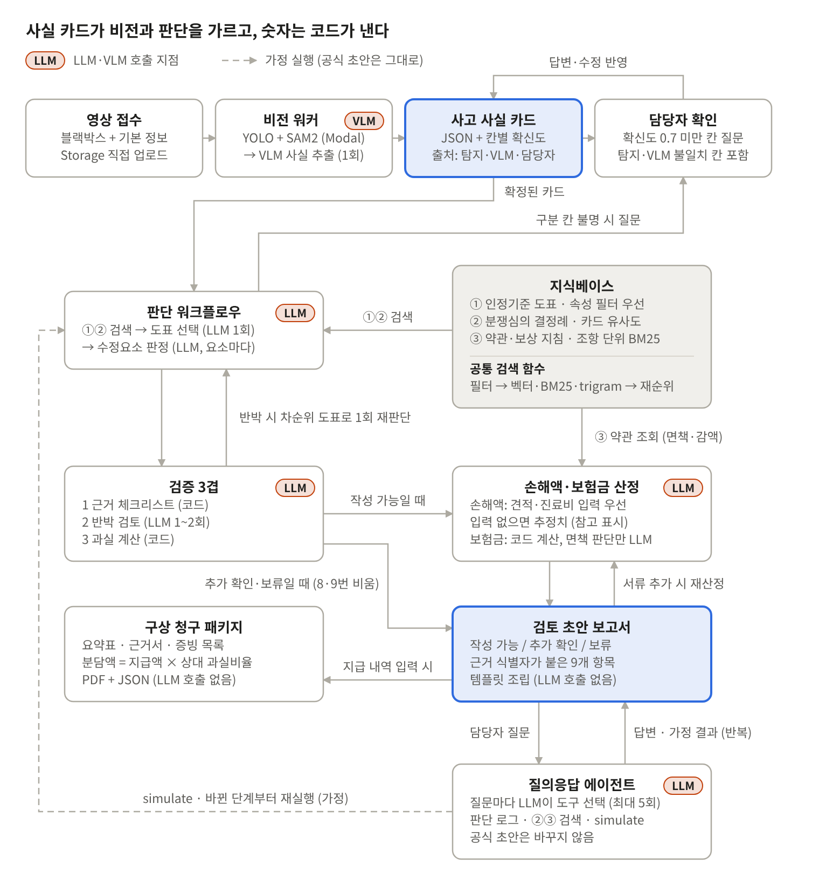
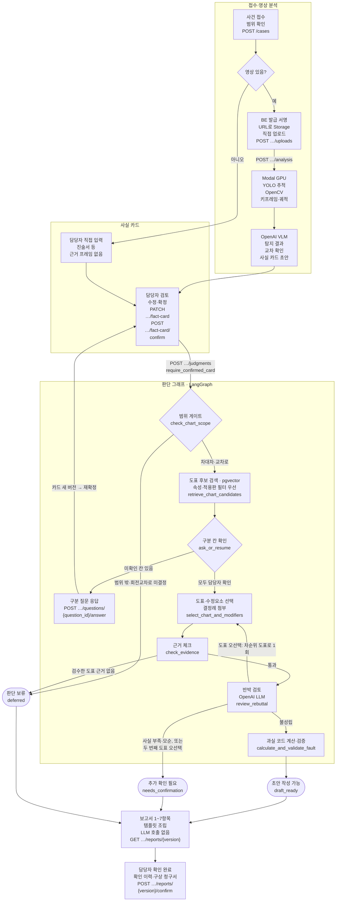

# ok-muncheol-be

**OK문철 — AI 기반 자동차보험 보상 의사결정 지원 솔루션의 백엔드**

블랙박스 영상이나 담당자가 입력한 사고 사실을 구조화하고, 과실비율 인정기준·분쟁심의 결정례에 근거한
**과실비율 검토 초안**을 제공한다. 최종 판단과 승인은 보상 담당자가 수행한다.

- 아키텍처 이미지: [accident-review-architecture-v7.png](docs/architecture/accident-review-architecture-v7.png) — 로컬 `ok-muncheol/서비스아키텍처` 원본, 2026-11-05 대조
- 프론트엔드: [ok-muncheol-fe](https://github.com/Ok-Muncheol/ok-muncheol-fe)
- 역할별 작업·완료 기준: [TEAM.md](TEAM.md)

현재는 **담당별 계약·모듈 초안 단계**다. `app/`, `workers/vision/`, 코퍼스/평가셋 양식과 검증 명령이 있다.
함수의 `NotImplementedError`·TODO는 담당자가 채운다. API는 인증(Supabase 토큰 검증)·`ApiError` 오류 응답·담당별 경로까지 연결했고, 서비스 본문이 비어 있는 경로는 501을 돌려준다. 판단 그래프·검증 3겹과 판단 접수·질문 응답 API(실행·질문·검증 로그·체크포인트 DB 저장)는 구현됐다. 공용 DB에는 사건·판단 테이블 마이그레이션이 적용돼 있다.
CI와 ship 하네스는 있다([브랜치·PR 규칙](#브랜치pr-규칙)).
공통 타입은 표준 라이브러리 TypedDict 초안으로, 런타임 요청 검증·Pydantic·OpenAPI는 후속 작업이다.

**개발 마감: 2026-11-13(금).** 11/12 기능 통합·11/13 최종 검수를 목표로 한다.
날짜별 담당 산출물과 완료 기준은 [개발 마감 계획](docs/development-plan.md)을 따른다.
FE의 대응 TEAM·타입·화면 초안은 [ok-muncheol-fe](https://github.com/Ok-Muncheol/ok-muncheol-fe)에 함께 반영한다.

## 서비스 범위

| 단계 | 범위 | 산출물 |
| --- | --- | --- |
| 선행 MVP | 차대차 사고, 영상 또는 수동 사실 카드 → 담당자 확인 → 도표·수정요소 판단 → 검증 | 근거가 있는 과실비율 검토 초안 |
| 1차 확장 | 차대차·자차, 약관 RAG, 손해액·보험금, 근거 질의응답·what-if, 구상 청구 | 자차 산정 보고서, 구상 패키지(PDF·JSON) |
| 2차 확장 | 이륜차, 대물·대인·자손·자상, 양방향 정산 | 담보별 산정과 정산표 |

차대보행자·차대자전거·PM·3대 이상 연쇄 사고·단독 사고는 범위 밖이다. 접수 시 사고 유형과 당사자 수를 확인한다.
영상이 없는 진술서 사건도 동일한 사실 카드를 직접 입력해 지원한다. 운전자보험은 포함하지 않는다.

## 핵심 원칙

1. **사실 카드 확정 후 판단한다.** 비전이 추출한 값·근거·확신도와 담당자의 수정 이력을 보존한다. 핵심 구분 칸이 불명하거나 충돌하면 질문하고, 확인할 수 없으면 보류한다.
2. **숫자는 코드로 계산한다.** 기본 과실·가감치는 사고 일자에 유효한 DB 레코드에서 읽는다. LLM이 생성한 비율이나 금액을 계산 입력으로 쓰지 않는다.
3. **근거가 있어야 초안을 낸다.** 도표 번호·적용판·수정요소 코드·인용 원문을 검증한다. 판례를 인용할 때는 판례 식별자도 검증한다.
4. **공식 판단은 고정 워크플로우다.** LangGraph의 조건 분기와 담당자 확인·재개로 실행한다. 확장 단계의 질의응답 에이전트는 설명·가정 계산만 하며 공식 결과를 직접 수정하지 않는다.
5. **단계별로 저장하고 재실행한다.** 카드·기준판·규칙·모델 버전과 실행 로그를 남긴다. 사실 변경 시 판단부터, 견적 추가 시 손해액·보험금부터 다시 실행한다.

## 아키텍처 원본과 적용 기준



이미지는 로컬 원본을 수정 없이 보관한 **확장 기능 포함 전체 흐름 참고도**다. 사실 카드 경계, 담당자 확인과
구분 질문, 근거 체크·반박 검토·코드 계산의 3겹 검증, 보고서 템플릿 조립, 서류 추가 재산정,
공식 결과와 분리된 what-if 실행 관계를 보여 준다. 모든 상자를 선행 MVP의 구현 범위로 해석하지 않는다.

이미지의 일부 상세 표기는 지금 적용하는 기준과 달라, 다음 항목은 오른쪽 기준을 따른다.

| 이미지 v7 표기 | 적용할 기준 |
| --- | --- |
| YOLO + SAM2 | YOLO를 우선 사용하고 SAM2는 개선 효과가 입증된 경우 선택적으로 추가 |
| 확신도 0.7 미만 칸 질문 | 핵심 필드의 불명·저확신·근거 불일치와 후보 도표 구분 칸으로 확인 여부 결정. 0.7은 이미지의 제안값이며 운영 임계값은 평가 후 확정 |
| 수정요소 판정 LLM, 요소마다 | 구조화 조건·증거 요구·중복/배타는 코드 우선, 해석이 필요한 요소만 LLM 보조·담당자 확인 |
| 공통 검색 함수: 필터→벡터·BM25·trigram→재순위 | 코퍼스별 검색 전략 적용. 도표는 속성·유효판 우선, 결정례는 유사도, 약관은 담보·조항 우선. 결합·재순위는 효과를 검증해 선택 |
| 손해액·보험금·약관·구상·질의응답과 9항목 보고서 | 선행 MVP는 과실비율 검토 1~7번, 1차에 자차·약관·what-if·구상과 8~9번 추가. 진료비·대인 등은 2차 |
| 분담액 = 지급액 × 상대 과실비율 | 구상 예정액의 단순 예시. 실제 청구·회수액은 계약·지급·정산 조건 검증 후 별도 관리 |

## 선행 MVP 처리 흐름



`…`는 `/cases/{id}`의 줄임이다. 판단 그래프 상자의 영문 이름, `require_confirmed_card`, 판정 상태(둥근 상자)를 만드는
`build_judgment_result`가 `app/workflow/graph.py` `STAGES`의 9단계다. 검증 3겹(근거·반박·계산)은 `app/validation/`,
보고서 조립은 `app/reports/`에 있다.
판단 그래프 9단계와 검증 3겹(`tests/workflow/`·`tests/validation/`), 판단 접수·질문 응답의 DB·체크포인트 저장
(`tests/api/test_judgment_service.py`)은 구현돼 있다. 도표 선택은 검수한 구조 레코드(`calculation_ready`)만 쓰므로, 김지은의 도표 레코드에 `chart_scope` enum으로
정규화한 속성이 검수 상태로 더해지기 전에는 "검수한 도표 근거 없음"으로 보류한다(`app/workflow/candidates.py`).

SAM2는 YOLO만으로 부족한 차로 점유·경계 확인에서 개선 효과를 검증한 뒤 선택적으로 추가한다.
마스크 접촉으로 실제 충돌을 확정하거나 픽셀 변위로 실제 속도·과속을 판정하지 않는다.

반박 검토는 성립 이유를 도표 오선택(`wrong_chart`)·구분 조건 등 사실 부족(`missing_fact`)·근거와 카드의 모순(`contradiction`)으로
나눠 적는다. 도표 오선택이면 차순위 도표로 선택·판정·검증을 한 번만 재실행하고, 두 번째 도표 오선택이면 ‘추가 확인 필요’로 내린다.
사실 부족·모순은 도표를 바꿔도 풀리지 않으므로 재실행 없이 바로 ‘추가 확인 필요’로 내리고 담당자 질문으로 남긴다. 같은 사실·기준판·계산 규칙에 대한 수치 계산은 재현 가능하게 만든다.

## 기술 구성

| 구성 | 기술 | 역할 | 지금 상태 (2026-11-10) |
| --- | --- | --- | --- |
| API | Python 3.12 · FastAPI · Vercel Functions · PyJWT | 사건·사실 카드·판단 실행·보고서·권한 | 운영 배포. 토큰은 Supabase JWKS(ES256)로 검증 |
| 비전 워커 | Modal · YOLO11s · OpenCV Farneback · VideoMAE · V-JEPA 2 · CLIP · scikit-learn | 차량 탐지·추적, 촬영 차량 움직임(광류), 영상 분류(미세조정), 작은 분류기 | 파이프라인 구현(`workers/vision/pipeline.py`: 영상 → 사실 카드 v1, [설명](workers/vision/README.md)). Modal 연결은 진행 중 |
| 사실 추출 | OpenAI VLM | 사진 12장 + 비전 결과로 사실 카드 초안 작성, 칸별로 비전 모델과 교차 확인 | `gpt-4o`(영상 1건 약 37원). 칸별 정확도는 [사실 카드 v1](docs/contracts/fact-card-v1.md) 3절. `gpt-4o`는 OpenAI가 스냅샷 종료를 2027-01-14로 공지 |
| 판단 | LangGraph · Postgres 체크포인터(psycopg) · OpenAI LLM | 고정 판단 그래프·구분 질문 재개·반박 검토 | 구현. LLM 모델은 `OPENAI_MODEL`(비우면 `gpt-4o-mini`. `.env.example`·운영도 `gpt-4o-mini`) |
| 검색·색인 | pdfplumber · OpenAI 임베딩(`text-embedding-3-small`) · Kiwi BM25 · pgvector | 코퍼스별 파싱·청킹·임베딩, 구조화 검색·한국어 BM25 | 검색은 메모리 색인(`InMemoryIndex`)으로 돈다. 로컬은 `LOAD_KNOWLEDGE_BASE=1`이면 서버 시작에서 db_import 파일로 켠다. 운영(Vercel)은 색인 파일이 배포에 없어서, 시작할 때 Supabase Storage 비공개 버킷 `corpus-index`의 사본(`CORPUS_IMPORT_PATH`)을 받아 SHA-256으로 검증한 뒤 켠다(2026-11-13). pgvector는 `VectorIndex` 교체 지점으로 남아 있다. LangChain은 LangGraph 설정 타입(`langchain_core`)만 쓴다 |
| 데이터·파일·인증 | Supabase Postgres · Storage · Auth · RLS | 사건·근거·비공개 영상·담당자 접근 통제 | 사건 접근·판단·보고서 마이그레이션 3개(`supabase/migrations/`) |
| 진행·관측 | Supabase Realtime · LangSmith · Vercel Observability | 작업 변경 알림·단계별 비용·처리 시간 | Realtime은 `judgment_runs`·`judgment_questions`를 발행한다. LangSmith는 아직 연결하지 않았다 |
| CI·배포 | GitHub Actions · Vercel Git 연동 | 머지 전 검사, `main` 배포 | Actions는 `check`(lint·check·test)와 `gitleaks`만 돌린다. 배포는 Vercel이 `main` push를 받아 한다 |

영상은 FE가 발급받은 서명 URL로 Storage에 직접 올리고 API에는 파일 경로·메타데이터를 전달한다.
비전 모델 가중치와 실행 환경(torch 등)은 API 함수에 넣지 않는다. Vercel Python 번들은 500MB까지인데 torch만 수백 MB다.
GPU가 필요한지는 서비스에 넣을 모델로 정한다. 지금 평가 코드의 YOLO·광류는 M4 Pro CPU에서 건당 약 1.9초다(평가 보고서 6·7절).
서비스와 로컬 비전 평가는 같은 패키지·가중치 버전을 쓴다.

**배포는 Vercel 프로젝트 `ok-muncheol-be`에 연결되어 있다(2026-11-06).** `main` push마다 Python 런타임이
`app/main.py`의 모듈 수준 `app`을 진입점으로 배포하고, 의존성은 `requirements.txt`(`.` → `pyproject.toml`)로 설치한다.
경로 16개가 배포되지만 서비스 본문이 빈 경로는 501 `not_implemented`를 돌려준다. 인증 환경 변수가 없으면 보호 경로는 503으로 닫힌다.
판단 경로는 서버 DB 주소 `DATABASE_URL`(Supabase Session pooler)이 없으면 503 `db_not_configured`, 반박 검토 키 `OPENAI_API_KEY`가
없으면 실행이 `dependency_not_ready`로 실패한다.
FE는 별도 Vercel 프로젝트 `ok-muncheol-fe`로 배포한다. 운영 주소는 FE `https://ok-muncheol-fe.vercel.app`,
BE `https://ok-muncheol-be.vercel.app`이다(2026-11-09 확인). 오리진이 달라 CORS는 `CORS_ALLOW_ORIGINS`에 적은 출처만 허용한다.
두 레포 모두 PR 브랜치는 배포하지 않고 `main`만 배포한다(`vercel.json`의 `git.deploymentEnabled`). Hobby는 배포를 하루(24시간)
100번까지만 만들어, PR push마다 Preview를 만들면 한도가 차서 `main` 배포까지 막힐 수 있다. 머지 전 확인은 CI `check`가 맡는다.

ship은 `main` 머지 → main CI → 머지 커밋의 Vercel 배포 결과와 `/health` 응답까지 확인한다(`automation/pipeline.md` Step 3).

## 사고 사실 카드 계약

비전과 판단은 이 카드만으로 연결한다. 다음은 초기 필드 합의안이며 실제 Pydantic·OpenAPI 스키마는 첫 계약 PR에서 확정한다.

| 영역 | 필드 |
| --- | --- |
| 사건 | `accident_type`, 사고 일시, 당사자 수 |
| 당사자 | `party_tracks`, `video_ego_party_id`, `insured_party_id`, `chart_party_A_id`, `chart_party_B_id` |
| 장소·신호 | `location_type`, `road_priority`, `signal_A/B` |
| 움직임 | `movement_A/B`, `entry_order`, `lane_change_A/B`, `motion_trend_A/B` |
| 보조 사실 | `night`, `collision_point`, `time_condition`, `narrative`, `evidence_frames` |

도표 선택에 쓰는 칸(`accident_type`·`location_type`·`road_priority`·`movement_A/B`·`signal_A/B`·`entry_order`·`night`)의
이름과 허용값은 `app/schemas/chart_scope.py`가 원천이다. 판단 그래프는 이 칸 중 `human_confirmed`인 값만 쓴다.

각 사실 필드는 `value`, `source`, `model_confidence`, `verification_status`, `evidence_frame_ids`를 가진다.
`needs_review`는 근거 충돌·확인 필요, `human_confirmed`는 담당자 확인을 뜻한다. 수동 입력에서 모델 확신도는
해당 없음으로 표현하고, 담당자 수정 때문에 원래 모델 확신도를 1.0으로 덮어쓰지 않는다.
영상이 없는 사건에는 근거 프레임이 없음을 명시하고 진술서 등 입력 근거를 별도로 연결하는 계약을 마련한다.

촬영 차량·보험가입자·도표 A/B·데이터셋 A/B를 같은 것으로 가정하지 않는다. 카드 확정 및 과실 계산 전에 매핑을 검증한다.
수정 전후 값, 수정자, 시각, 근거와 사유를 이력으로 남긴다.

## 지식베이스·판단 규칙

| 코퍼스 | 주요 레코드 | 검색과 사용 단계 |
| --- | --- | --- |
| ① 인정기준 | `chart`, `modifier`, `chart_relation`, `precedent` | 사실 속성·`condition_json`·사고 일자에 유효한 판으로 후보 제한, 과실 판단 |
| ② 분쟁심의 결정례 | `dispute_case` | `chart_id` 필터 후 유사 사실 검색, 벡터·Kiwi BM25 결합은 평가 후 적용 |
| ③ 약관·보상 지침 | `term_clause` | 1차 확장부터 담보·조항 필터, 보상 범위·면책 검토에 사용 |
| 공통 색인 | `search_chunk`, `token_stats` | 근거 원문·부모 ID·버전 보존, 코퍼스별 토큰 통계 |

①·②와 ③의 검색 범위를 섞지 않는다. 구조화 조건을 우선하며 RRF·재순위·Contextual Retrieval은 코퍼스별
효과를 측정해 채택한다. 도표는 개정 전 판도 보존하고 사고 일자로 조회한다. 수치는 청크 서술이 아닌 DB에서 읽는다.

```text
fault_A = clip(base_A + sum(delta of A modifiers) - sum(delta of B modifiers), 0, 100)
fault_B = 100 - fault_A
```

수정요소의 조건·증거 요구사항·중복·상호배타·적용 방향·부호를 코드로 검증한다.
근거가 없는 수정요소는 임의 적용하지 않는다.

## 판정 상태와 보고서

작업 진행 상태와 판정 결과는 별개다. 작업이 끝나도 결과는 보류일 수 있다.

| 판정 | 조건·화면 동작 |
| --- | --- |
| 초안 작성 가능 | 필수 증거·확인·근거 검증·반박 검토·수치 계산을 통과해 담당자 검토용 초안 제공 |
| 추가 확인 필요 | 답변 가능한 불명·충돌 또는 반복 반박이 남아 질문과 쟁점 제공 |
| 판단 보류 | 구분 불가·확인 불가 또는 범위 밖 사유 제공, 확정 비율로 표시하지 않음 |

MVP 보고서는 ① 판정 상태 ② 확정 사실·근거 키프레임 ③ 적용 도표·차순위 후보·선택/제외 이유
④ 기본 과실 ⑤ 적용/미적용/불명 수정요소 ⑥ 최종 과실비율 초안·계산 로그 ⑦ 추가 확인 사항으로 구성한다.
템플릿과 검증된 판단 결과로 조립하며 보고서 작성용 LLM을 추가 호출하지 않는다. 담당자 승인은 별도 이력으로 저장한다.
③④⑤는 판단 결과의 `alternatives`·`base_fault_A`·`modifiers`(`app/schemas/judgment.py`)로 채운다.
근거가 부족한 사건은 확인·보류 결과만 제공한다. 담당자 승인 없이 외부 전달하지 않는다.

## 디렉터리 초안

아래 디렉터리와 담당별 파일을 생성했다. 존재 여부는 기능 구현 완료를 뜻하지 않는다.
세부 파일·입출력·할 일은 [TEAM.md](TEAM.md)에 있다.

```text
app/
  api/              정지원 사건/카드, 구준휘 판단/질문/QA, 옥석현 보고서/산정/구상 진입점
  schemas/          공통 TypedDict 초안·합성 견본 (런타임 검증 미구현)
  workflow/         구준휘 state·고정 그래프·확인/재개
  validation/       구준휘 근거·반박·코드 과실 계산 검증 3겹
  agents/           구준휘 근거 질의응답·what-if
  tools/            김지은 인정기준·결정례·약관 검색 도구 3개
  ingestion/        김지은 PDF 파싱·청킹·문서 임베딩·적재
  retrieval/        옥석현 공통 RAG·질의 임베딩·코퍼스별 검색 실행
  calculation/      옥석현 손해액·보험금 (과실 산식은 구준휘 validation/numerical.py)
  claims/           옥석현 구상 패키지
  reports/          옥석현 템플릿 조립·버전/승인
workers/vision/     정지원 로컬/Modal 공통 비전 진입점
supabase/migrations/  DB·RLS 마이그레이션(사건 접근 기반·판단 테이블)과 담당별 추가 계획
data/corpora/       김지은 세 코퍼스 manifest 양식 (원문/색인 없음)
evals/retrieval/    김지은 평가셋 타입·합성 미라벨 양식·평가 진입점
tests/              API·검색·비전 평가·마이그레이션(migrations/)·ship 스크립트(automation/) 테스트
scripts/            문법/import/JSON 검사·공통 견본 생성
docs/               일정·공통 계약·아키텍처 이미지
automation/         ship 하네스 명세·게이트/폴링 스크립트·민감 파일 훅
```

## API 계약 제안

아래 표가 **경로의 기준**이다. `app/api/routes.py`가 이 경로로 연결돼 있고, 서비스 본문이 빈 경로는 501을 돌려준다.
`tests/api/test_app.py`가 이 표와 서버 OpenAPI를 대조한다. 인증·오류 응답·확장 경로는 [공통 계약](docs/contracts/README.md)에 있다.
필드·비동기 재개 방식은 담당 구현 PR에서 OpenAPI와 예제로 고정한다.

| 요청 | 목적 |
| --- | --- |
| `POST /cases` | 사건 생성·범위 검사 |
| `POST /cases/{id}/uploads` | 견적서·영상 업로드 서명 URL 발급(`kind`·`content_type`) → FE가 받은 URL로 Storage에 직접 업로드 |
| `POST /cases/{id}/analysis` | 영상 분석 작업 접수 |
| `GET /cases/{id}` | 진행 상태·확인 질문·현재 버전 복원 |
| `GET /cases/{id}/fact-card` | 모델 원값·현재 값·근거·확인 상태 조회 |
| `PATCH /cases/{id}/fact-card` | 기대 카드 버전과 수정 내역 전달 |
| `POST /cases/{id}/fact-card/confirm` | 담당자 카드 확정 |
| `GET /cases/{id}/evidence` | 근거 사진·미리보기 영상의 보기용 서명 URL(1시간) |
| `POST /cases/{id}/questions/{question_id}/answer` | 도표 구분 질문 응답·카드 이력 반영 |
| `POST /cases/{id}/judgments` | 확정 카드 버전으로 판단 작업 접수·재개 |
| `GET /cases/{id}/judgment` | 최신 판단 실행·판정·구분 질문과 답 조회(새로고침·재접속 복원) |
| `POST /cases/{id}/qa` | 근거 질의응답·what-if — 판단 로그·결정례·약관 검색·가정 실행으로 답하고 공식 판단·보고서는 바꾸지 않음 |
| `GET /cases/{id}/reports/{version}` | 버전별 보고서·근거·판정 조회 |
| `POST /cases/{id}/reports/{version}/confirm` | 담당자 확인 완료 1회·확인 이력 저장, 조건이 맞으면 구상 청구서 생성 |
| `GET /cases/{id}/reports/{version}/claim` | 그 보고서 버전으로 만든 구상 청구서 조회 |
| `POST /cases/{id}/documents` | 계약·견적·증빙 서류와 면책 체크 추가 → 자동 재산정 |
| `POST /cases/{id}/estimates` | Storage에 올린 견적서 PDF 경로 전달 → 자동 추출·재산정 |
| `PATCH /cases/{id}/agreed-fault` | 협의 과실 입력·해제 → 구상 금액 재계산 |

합의할 공통 계약은 사건 ID, 카드/보고서 버전, 작업 ID·단계·진행 상태, 판정 상태, 확인 질문,
근거 ID·타임스탬프, 오류 코드·재시도 가능 여부다. 오래된 카드에 대한 덮어쓰기와 중복 실행을 막는다.
재시도에는 사건 ID + 단계 + 입력 버전 기반 멱등성 키를 사용한다. Realtime은 변경 알림으로 사용하고
재접속·새로고침 후에는 조회 API로 현재 상태를 복원한다.

## 개발 시작과 검증

Python 3.12 이상에서 가상환경을 만들고 검증 도구(ruff·pytest)를 설치한다. 모델 키·DB는 필요 없다.
DB 검사(마이그레이션·판단 저장)까지 돌리려면 `supabase/migrations/README.md` 「로컬 검사」대로 Docker Postgres를 띄우고
`MIGRATION_TEST_DATABASE_URL`을 준다.

```bash
python3 -m venv .venv
.venv/bin/pip install -e ".[dev]"
make lint       # ruff
make check      # Python 문법·import·타입 참조·JSON·견본 동기화
make test       # pytest — tests/ 전체(API·검색·코퍼스·비전 평가·ship 스크립트)
.venv/bin/uvicorn app.main:app --reload  # 로컬 서버. .env.example 참고
make contracts  # app/schemas/examples.py → docs/contracts/examples.json
```

CI `check`가 lint → check → test를 같은 순서로 돌리고, 버려도 되는 Postgres 서비스로 마이그레이션·판단 저장 동작도 검사한다.
모델·Supabase 실환경은 검증하지 않는다.
서버 환경 변수 양식은 `.env.example`이다. 로컬에서 토큰 없이 부르려면 `APP_ENV=local`과 `DEV_ACTOR_ID`를 함께 둔다(Vercel 위에서는 꺼진다).
근거 검색·면책 조항 판정(D 지식베이스)은 `LOAD_KNOWLEDGE_BASE=1`일 때만 서버 시작에서 켜고, 시작이 돌지 않았거나 실패했으면 첫 요청에서 켠다. 로컬은 `data/private/corpus-db-import/db_import`와 OpenAI 키가 필요하고 시작에 몇 초·약 300MB가 든다. 운영은 `CORPUS_IMPORT_PATH`(예: `corpus-index/20261113-1118`)의 비공개 Storage 사본을 `/tmp`로 받아 `SHA256SUMS.txt`와 대조한 뒤 읽는다(`app/corpus_import.py`). `CORPUS_IMPORT_EVIDENCE_STORE=1`이면 그 사본으로 운영 근거 검증(EvidenceStore 로컬 어댑터)도 켠다. DB 색인 어댑터가 오기 전 임시다. 새 적재 파일이 오면 같은 버킷에 새 접두어로 올리고 이 값을 바꾼다. 파일·키가 없거나 못 쓰면 경고 로그만 남기고 꺼진 채로 시작한다(면책은 담당자 입력으로 판정).
LLM·VLM·Modal·DB 비밀키는 서버에서만 관리하며 실제 사건·원문은 커밋하지 않는다.
견본 생성/FE 동기화는 [공통 계약](docs/contracts/README.md), 담당별 작업은 [TEAM.md](TEAM.md)를 따른다.

평가는 영상→카드와 카드→판단을 분리한다. 먼저 정답 카드로 S0(벡터 검색 기준선), S1(속성 필터·검색 개선),
S2(고정 판단·검증)를 비교하고, S3(VLM), S4(YOLO·선택적 SAM2), S5(담당자 확인) 순으로 확장한다.
도표 Top-1·Recall@3, 수정요소 정밀도·재현율, 비율 MAE(%p)·±5%p 적중률, 고확신 오류율·보류율,
담당자 수정 횟수·처리 시간 p50/p95·비용을 함께 기록한다. 목표 수치와 데이터 규모는 아직 확정하지 않았다.

## 브랜치·PR 규칙

역할별 담당과 완료 기준은 [TEAM.md](TEAM.md)에 있다. FE 레포와 같은 규칙이다.

feature → `main`으로 올린다. 배포 환경이 `main` 프로덕션(Vercel) 하나뿐이라 `dev`를 따로 두어도 나뉘는 환경이 없다.
스테이징 환경이 생기면 그때 `dev`를 추가한다.

1. 이슈를 템플릿(기능 구현 · 기능 수정 · 오류 수정 · 리팩토링 · 문서 작업 · 기타 수정)으로 만든다.
2. `main`에서 `<타입>/#<이슈 번호>` 브랜치를 만든다. 예: `feat/#12`, `chore/#13`
3. `main`으로 PR을 올린다. 제목은 `[타입/#이슈 번호] 설명`(예: `[feat/#12] 사실 카드 확정 API를 추가한다`)이고
   본문에 `close #이슈 번호`, 검증 결과, 계약을 바꿨으면 대응 FE PR을 적는다.
   CI(`check`: ruff · `make check` · pytest, `gitleaks`)를 통과해야 머지할 수 있고, squash merge한다.

`main`은 PR 필수(승인 0명), 필수 체크 `check`·`gitleaks`, 강제 푸시·삭제 금지로 보호한다.

위 1~3을 자동화한 것이 **ship 하네스**다. 코드 수정을 끝낸 뒤 Claude Code에서는 `/ship`, Codex에서는
`$ship`(또는 "ship"·"배포해줘")으로 부르면 검증(`make lint`·`make check`·`make test`) → 이슈·브랜치 생성 → PR →
CI 게이트 → squash 머지 → main CI 확인 → (Vercel 연결 시) 프로덕션 배포 확인까지 진행한다. 절차 원본은
하네스 중립 명세 `automation/ship.md`·`automation/pipeline.md`이고, `.claude/commands/ship.md`와
`.agents/skills/ship/SKILL.md`는 각 하네스의 진입 어댑터다. 폴링·게이트 스크립트(`automation/bin/`)는 표준
라이브러리만 쓰는 Python이라 bash·jq가 필요 없고, `tests/automation/`이 `make test`로 회귀 검증한다. 처음 쓰는
PC에서 할 준비(도구 설치·로그인, Codex 설정, Windows)는 [`automation/README.md`](automation/README.md)에 있다.

## 협업·데이터 관리

- AI Hub 원본 영상은 설계대로 로컬 학습·평가용으로만 보관한다. 서비스·공개 시연에는 사용 권리를 확인한 별도 영상을 쓴다.
- 인정기준·결정례·약관의 재가공·배포 범위와 모델·가중치 라이선스는 확인 전 공개 저장소에 원문·가중치를 올리지 않는다.
- 얼굴·번호판·위치정보 처리, 외부 VLM 전송, 접근 권한·보관·삭제 정책은 실데이터 연동 전 확정한다.
- 담당자 실명 배정·세부 작업 시간, 도표/라벨 매핑·적용판, 시연 데이터 확보는 [TEAM.md](TEAM.md)의 초기 작업에서 결정한다.
